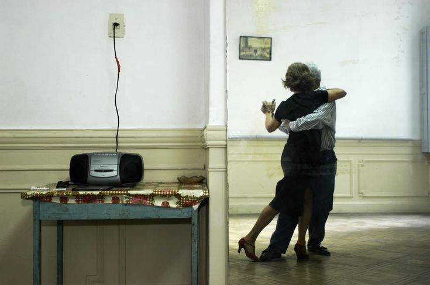

my fingers skim the rough surface of the table, tracing the grain, as if the wood could tell me something it’s holding back. the chair across from me sits empty, yet its presence is undeniable—like an absence made of too many words left unsaid, a silence too heavy to ignore. it stares at me with its empty seat, a vacant witness to everything and nothing at once, and something inside of me tightens. the weight of that emptiness is like a tight knot in my chest, one that i can’t undo, no matter how hard i try to breathe through it. there is a bitterness in its quiet that cuts deeper than any harsh word could. it feels like the hollow ache of a memory i haven’t fully remembered yet.

the fire dances before me, flickering and spinning in wild, chaotic patterns. it feels almost like a game—an unruly child pulling at the threads of my thoughts, setting them alight and watching them burn. i smile, not out of joy but out of something else—a bitter kind of acceptance, maybe, or an attempt to soothe the fire inside me by mirroring its movement. it’s warm, but there’s a distance to the heat, like it knows me too well to try and comfort me. the flames hold secrets, ancient and untold, flickering in their brief, ephemeral lives—but the shadows around me know them all, keeping them hidden, tucked away in the corners where even time can’t reach.

i watch as the shadows stretch, long and twisted, reaching for me, pulling me in like i’m a part of them, like i’ve always been. time is a thing that presses in on me, like the weight of the world resting on my chest, crushing the breath out of me with every passing second. does grief ever really stop? or does it, like the shadows, just learn to stretch and change shape until it becomes something else—something you can’t quite see, but you feel it, always lingering just beneath the surface? there’s a gnawing truth that i can’t shake—that mourning never truly ceases. it doesn’t fade or heal. it just shifts, becoming a part of you, woven into the threads of your skin until it’s indistinguishable from who you are.

the air smells like things that have been left behind—forgotten, maybe, or just *lost* in the passing of time. it’s a scent of soft decay, a bittersweet perfume that clings to the edges of everything, lingering in places where memories are too afraid to come out of hiding. the scent wraps itself around my heart, pulling me back, pulling me into the past, where things made sense, where there was *wholeness*. but nothing is whole now. nothing is as it was. and yet, i can’t stop reaching for that familiar feeling—the thread of something that still tugs at me, pulling me through the fog of it all.

and then, in the midst of all this—this twisting, this burning, this ache—there’s *you*. not in any obvious way, not in a touch or a voice, but in a presence that fills the space in a way nothing else can. it’s like the fire has calmed, the shadows have softened, and everything has quieted just enough for me to feel you again. and for a moment, just a fleeting moment, i can breathe. i can feel the weight in my chest lift, like someone has taken a step toward me and held their hand out, offering me a part of them that i’ve lost in myself.

you make me feel *whole* again. not because you’ve fixed me, not because anything is suddenly perfect, but because you’ve reminded me of what it feels like to be more than just the cracks that life has carved into me. in your presence, i can feel the pieces that have scattered, the parts i thought i lost forever, quietly moving back into place. it’s not a loud, triumphant return; it’s quiet, almost imperceptible, like a sigh escaping from somewhere deep inside, but it’s enough.

for a moment, i remember that i was once more than the weight of what’s been lost. i remember that, maybe, i could be something more than the sum of my grief, my anger, my regret. and that, in itself, is enough to make me feel human again. to make me feel like i am whole again.
