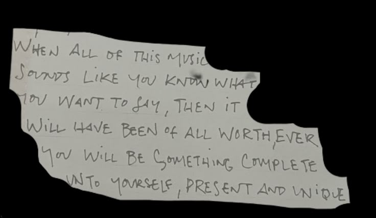

i first found jeff buckley a few years ago. it wasn’t some sudden lightning bolt; it was more like slowly sinking into a river of sound that carried me somewhere unexpected. his voice wasn’t just singing; it was a trembling pulse, fragile and raw, like hearing a wound breathe in the silence, it wasn’t about perfection or polish. jeff’s voice was bruised and ragged in all the right ways, a voice that held the weight of broken things and refused to let go. when he sang, it felt like he was pulling apart the quiet inside me, stitching it back together with each note. that kind of sound doesn’t just enter your ears; it settles in your bones.

jeff buckley was a restless spirit, wrapped up in contradictions. wild but tender, fragile yet fierce. he wore his vulnerability openly, but never like a weakness. it was part of his strength, the way his voice could tremble with doubt one moment and explode with passion the next. listening to him, i felt like i was witnessing a man trying to hold together pieces of himself that didn’t quite fit; the hope and the fear, the beauty and the chaos. his voice carried all of it, as if he was sharing something deeply private but somehow universal, something that needed to be heard even if it hurts.

he wasn’t alone in this journey. michael tighe on guitar, mick grondahl on bass, and matt johnson on drums weren’t just supporting players. they were the backbone of that fragile, fierce sound. their playing wasn’t just accompaniment; it was a conversation, a kind of shared breathing that shaped every moment. the way they moved between hushed intimacy and crashing intensity made the music feel alive and unpredictable, like it could break or soar at any second. there was a deep trust there, like they were holding something precious together, and you could feel it in the silences as much as in the notes.

jeff’s relationship with songwriting was complicated. in the ’90s, you had to prove your worth by writing your own songs, and jeff felt that pressure sharply. sometimes his songs felt tangled, caught in his own expectations and overthinking. but when he sang covers, he could finally breathe. songs like hallelujah weren’t just performances; they were rebirths, moments where jeff let go of control and simply became the music. in those moments, he disappeared into the song and brought something new and haunting back with him. it’s no surprise that hallelujah is what so many people remember; it’s raw and tender and infinite all at once.

grace is more than an album. it’s a confession, a map of a soul laid bare. hallelujah feels like a prayer whispered in the dark, broken and trembling with all the cracks in jeff’s voice. lover, you should’ve come over is a slow bleed of longing, a desperate reaching through the static for something lost, a memory folding back on itself like smoke. every song on that record is a piece of jeff’s complicated heart, a moment caught in time that still feels alive and aching.

his demos are something else entirely; unpolished, messy, utterly alive. there’s no safety net in those recordings. it’s just jeff, pushing his voice to the edge, exposing every raw nerve. it’s the kind of honesty that can be almost unbearable but also deeply necessary. listening to them, you hear the man behind the myth, the artist wrestling with his own humanity.

and then there is jeff’s journal. those words are like shards of glass caught in sunlight; sharp, honest, searching. through them, you glimpse the man beneath the music, a soul grappling with faith and doubt, with a love so fierce it almost burns him. those reveal someone wrestling not just with art but with the weight of being alive, of feeling too much and trying to make sense of it all.

twenty-eight years have passed since jeff’s voice was silenced, but his absence still echoes like a wound that never quite closes. yet in that absence, his music remains; fragile, wild, fierce, and whole. it is a doorway into a place where pain and beauty collide, where brokenness becomes something powerful and tender at the same time.

thank you, jeff, for your wounded light that still cuts through the dark. for your voice that trembles and soars, for showing us how to be broken and unbreakable all at once. your music is a flame that refuses to die, lighting up the shadows in ways no one else ever could.
